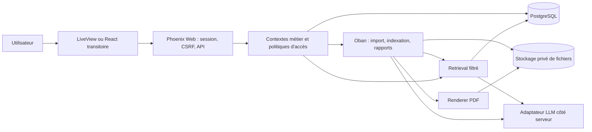

# Architecture cible — Phoenix, assistant documentaire et rapports

Statut : architecture cible et fondations en cours d'implémentation, 21 octobre 2026. Le dossier `backend/` contient l'application Phoenix, l'authentification, le périmètre client, le premier schéma RAG/rapports et les contrats API initiaux.

## 1. Choix structurants

Une application Phoenix unique, organisée en contextes métier, est le point de départ. Elle fournit la session, les autorisations, les données, les tâches de fond, l'assistant et les rapports. PostgreSQL est la source de vérité ; les fichiers originaux et exports sont placés dans un stockage privé. LiveView devient progressivement le frontend principal selon le plan `REFONTE_FRONT_PHOENIX_RAG.md`. Durant la transition, le React existant ne parle qu'à une API Phoenix authentifiée pour les parcours migrés.

Ne pas réutiliser le schéma MySQL optionnel, les données `src/data`, les sélections de rôle du navigateur ou les règles Firestore actuelles comme modèle de sécurité. Les données réelles ne sont migrées qu'après inventaire, rapprochement et validation de leur provenance.



## 2. Contextes Phoenix et frontières

| Contexte | Responsabilité | Données principales |
| --- | --- | --- |
| `Accounts` | identité, sessions, invitations, désactivation | `users`, `sessions` |
| `Organizations` | clients, marques, appartenances, rôle et périmètre | `clients`, `brands`, `memberships` |
| `Work` | briefs, tickets, affectations, validations | `briefs`, `tickets`, `approvals` |
| `Knowledge` | fichiers, versions, extraction, validation, index | `documents`, `document_versions`, `knowledge_chunks`, `index_generations` |
| `Assistant` | conversations, retrieval, génération, citations | `conversations`, `messages`, `message_citations` |
| `Reporting` | demandes, jeux de données, brouillons, révisions, export | `report_requests`, `report_snapshots`, `report_versions`, `report_citations`, `report_exports` |
| `Audit` | événements immuables de sécurité et de workflow | `audit_events` |

Les contrôleurs et LiveViews appellent ces contextes avec un `RequestScope` construit depuis la session : `user_id`, `client_ids` autorisés, rôle effectif, permissions et éventuel `active_client_id`. Le client actif est validé contre les appartenances à chaque requête. Les fonctions de service et requêtes Ecto vérifient le périmètre ; un affichage conditionnel dans l'interface ne vaut jamais autorisation.

Pour les opérations sensibles, encapsuler mutation métier, transition d'état et événement d'audit dans une transaction Ecto. Prévoir une version de ligne ou un verrou pour éviter deux validations concurrentes. Les tâches de fond doivent reprendre le périmètre par identifiants, puis le revérifier lors de l'exécution.

## 3. Modèle de données minimal

Toutes les tables métier portent `client_id` directement ou via un parent obligatoire. Clés étrangères, contraintes d'unicité et index portent ce périmètre. Les UUID peuvent servir d'identifiants publics ; les références métier sont générées côté serveur.

| Table | Champs indispensables |
| --- | --- |
| `memberships` | `user_id`, `client_id`, `role`, `status`, `permissions`, dates de validité |
| `documents` | `client_id`, `brand_id`, propriétaire, classification, statut, version courante |
| `document_versions` | `document_id`, numéro, `storage_key`, SHA-256, MIME, taille, auteur, approbateur, statut, date |
| `knowledge_chunks` | `document_version_id`, page/section, ordre, texte, langue, empreinte, `index_generation_id`, éventuel embedding |
| `conversations` / `messages` | `client_id`, `user_id`, agent/prompt version, rôle, texte, état `grounded`, modèle, horodatage |
| `message_citations` | `message_id`, `document_version_id`, `chunk_id`, page, extrait, rang |
| `report_requests` | `client_id`, période, marques, type, sections, demandeur, état, échéance |
| `report_snapshots` | `report_request_id`, période et filtres, références des données, valeurs KPI calculées, qualité, horodatage |
| `report_versions` | `report_request_id`, numéro, sections éditables, auteur, statut, prompt/modèle, `snapshot_id` |
| `report_citations` / `report_exports` | liens à versions de documents/données ; format, clé privée, hash et version du rapport |

Une suppression ou révocation de document invalide ses chunks actifs. Les historiques conservent les références de provenance, mais l'accès au contenu et à l'export est revérifié à l'ouverture. Les imports conservent le fichier d'origine et les erreurs de ligne ; aucune valeur absente ne devient un KPI inventé.

## 4. Assistant IA et RAG

### Ingestion

1. Upload privé avec contrôle de type/taille, empreinte, analyse de sécurité et enregistrement de version.
2. Extraction du texte en tâche de fond ; statut `extracting`, `needs_review`, `approved`, `rejected` ou `failed`. L'OCR est un traitement distinct et son résultat reste soumis à validation.
3. Découpage par page/section, avec métadonnées de source et de version. Indexation uniquement des versions approuvées et accessibles.
4. Démarrer par recherche textuelle PostgreSQL avec filtres `client_id`, droits, statut et version active. Ajouter une recherche vectorielle pgvector puis hybride après un banc d'essai sur de vraies questions métier. Une recherche textuelle seule est nommée « recherche textuelle ».

### Requête

```text
session -> scope -> question et filtres permis
  -> recherche dans les sources autorisées
  -> revérification des versions et accès
  -> contexte borné et prompt versionné
  -> fournisseur LLM côté serveur
  -> vérification de la réponse et des citations
  -> revérification d'accès avant affichage
  -> message enregistré + audit
```

Le navigateur transmet question, conversation et filtres demandés ; il ne transmet ni `systemPrompt` faisant autorité, ni chunks, ni rôle. Le serveur borne la taille, le nombre d'extraits et le coût. Les documents sont traités comme données non fiables : leurs instructions ne peuvent modifier ni les règles d'accès ni le comportement des outils.

Contrat de réponse : `answer`, `grounded`, `citations: [{document_version_id, title, page, excerpt, url}]`, `limitations`, `request_id`. Si aucune source vérifiée ne soutient la réponse, `grounded: false` et `citations: []` ; le texte le signale clairement. Une simple liste de sources transmises au modèle ne suffit pas à prouver qu'une affirmation est fondée.

L'adaptateur `LLMProvider` encapsule le fournisseur retenu, ses erreurs et son budget. Clé uniquement côté serveur. L'envoi de documents à un fournisseur externe reste désactivé jusqu'à validation explicite des conditions de conservation des données et du périmètre autorisé. Le streaming peut être ajouté après la validation de ce contrat, sans changer les contrôles d'accès.

### État du lot Groq au 21 octobre 2026

- `McCannBridge.Assistant.GroqProvider` appelle le point d'entrée Chat Completions compatible OpenAI avec `Req`. Le modèle par défaut est le modèle de production `openai/gpt-oss-20b` et sa sortie suit un schéma JSON strict.
- Phoenix construit lui-même le prompt et les extraits. Le navigateur ne peut fournir ni prompt système, ni rôle, ni chunks.
- Le fournisseur renvoie les identifiants des sources réellement utilisées. L'orchestrateur refuse les identifiants inventés, exige les repères `[S1]`, `[S2]`, puis recharge les chunks approuvés et l'appartenance active avant d'exposer les citations.
- La génération reste désactivée tant que `RAG_EXTERNAL_GENERATION_ENABLED`, `GROQ_ZDR_CONFIRMED` et `GROQ_API_KEY` ne sont pas configurés côté serveur. `GROQ_ZDR_CONFIRMED` est une attestation d'exploitation ; l'application ne peut pas lire le réglage Data Controls du compte Groq.
- La recherche actuelle est textuelle PostgreSQL. Les embeddings, la recherche hybride, la persistance des conversations, l'audit d'usage et le streaming restent dans les lots suivants.

## 5. Génération de rapports

Le rapport n'est pas une réponse de chat imprimée. Il se compose de chiffres déterministes, de commentaires assistés et de validations humaines.

```text
Demande -> collecte des données autorisées -> contrôle de qualité
        -> snapshot immuable des KPI calculés
        -> retrieval documentaire sur la même période et le même client
        -> brouillon narratif IA avec références
        -> revue et corrections par analyste McCann
        -> validation client si le workflow l'exige
        -> export PDF versionné -> partage autorisé
```

- Les KPI, taux, comparatifs et montants sont calculés par des fonctions métier testées, avec unité, période, dénominateur et source. Le LLM ne les calcule pas et ne crée pas de valeurs manquantes.
- Un `report_snapshot` fige les données utilisées. La régénération crée une **nouvelle version** ; elle n'écrase pas une version validée. Un jeu de données incomplet produit un état `needs_data` et des sections explicitement indisponibles.
- Le LLM ne rédige que des sections autorisées par un modèle de rapport versionné. Chaque affirmation chiffrée est confrontée au snapshot ; chaque affirmation documentaire exige une citation. Les écarts bloquent la publication et passent en revue.
- Workflow minimal : `requested → collecting → needs_data | draft → internal_review → client_review → approved → published`. Rejet ou demande de correction crée une nouvelle révision. Seuls les rôles autorisés déclenchent les transitions.
- L'export PDF est produit côté serveur depuis une version approuvée, avec sommaire, période, méthodologie, sources, date et numéro de version. Le choix du moteur PDF est à valider par un prototype de rendu sur un vrai modèle ; l'API métier ne dépend pas de ce moteur. Le lien de téléchargement est privé, temporaire et vérifié à chaque accès.
- Un export CSV ou XLSX, s'il est proposé, reprend le snapshot et ses sources. Aucun export ne doit reprendre les cinq lignes de démonstration de `ReportExportModal.jsx`.

Les traitements longs passent par Oban : `ExtractDocument`, `IndexVersion`, `ComputeReportSnapshot`, `DraftReport`, `RenderReportPdf`. Les jobs portent des identifiants, pas les contenus sensibles ; ils sont rejouables, suivent leur état et évitent les doublons par clé de demande/version. Une contrainte en base protège aussi les invariants que l'unicité des jobs ne garantit pas à elle seule.

## 6. Contrats web pendant la migration

La future interface LiveView appelle les contextes directement. Pour React transitoire, exposer une API JSON versionnée derrière session authentifiée et protection CSRF, ou un mécanisme d'authentification API dédié si une origine distincte est nécessaire. Schémas de requête et réponse documentés avant branchement du client.

| Route indicative | Action |
| --- | --- |
| `POST /api/v1/documents` | créer un upload ; retour d'un identifiant et état d'ingestion |
| `GET /api/v1/documents/:id/versions/:version` | métadonnées et lien de fichier autorisé |
| `POST /api/v1/conversations/:id/messages` | envoyer une question ; retour structuré et citations |
| `POST /api/v1/report_requests` | demander un rapport et définir son périmètre |
| `GET /api/v1/report_requests/:id` | état, qualité des données, versions |
| `POST /api/v1/report_requests/:id/generate` | déclencher snapshot et brouillon, avec clé d'idempotence |
| `POST /api/v1/report_versions/:id/transitions` | transition contrôlée et auditée |
| `GET /api/v1/report_versions/:id/export.pdf` | téléchargement après contrôle d'accès |

Ce sont des contrats cibles, pas des routes existantes. `vercel.json` renvoie actuellement toutes les routes vers `index.html` ; il faudra router `/api/*` vers Phoenix ou servir le nouveau frontend depuis Phoenix lors du basculement. Ne pas laisser deux sources de vérité écrire le même objet. Retirer les accès directs à Firestore après migration des parcours, puis fermer ses règles avant toute donnée réelle.

## 7. Ordre d'implémentation et preuves attendues

1. **Fondations** : créer `backend/` Phoenix, PostgreSQL, migrations, comptes, clients, memberships et politiques d'accès. Tests : lecture et mutation croisées interdites, rôle modifié dans le navigateur sans effet.
2. **Documents** : upload privé, version, extraction, revue, recherche textuelle autorisée. Tests : fichier réel, révocation, changement de version, fuite inter-client impossible.
3. **Assistant** : réponse fondée avec citations cliquables ; réponse non fondée signalée ; provider désactivable. Tests : citation provenant de la bonne version, aucune citation inaccessible, échec fournisseur explicite.
4. **Rapports** : un modèle réel, par exemple bilan hebdomadaire d'influence, avec données validées et KPI déterministes ; workflow de revue ; PDF versionné. Tests : calculs et provenance, données manquantes, régénération, permissions de publication et téléchargement.
5. **Migration UI** : écrans LiveView responsive pour ces parcours, puis autres modules. Tests navigateur à 320/768/1440 px, clavier, état vide/erreur et long contenu.

Critère de mise en service : aucun KPI fictif ou réponse simulée présentée comme résultat réel ; aucune source non autorisée dans le prompt, la réponse ou le PDF ; publication uniquement après validation humaine ; journaux permettant de retrouver la version des données et documents utilisés.

## 8. Décisions encore ouvertes

Ces décisions n'empêchent pas de démarrer les fondations, mais doivent être arrêtées avant le lot correspondant : fournisseur d'identité/SSO, hébergement des fichiers et durée de conservation, fournisseur LLM et conditions contractuelles d'usage des documents, corpus documentaire autorisé, premier modèle de rapport et ses sources de KPI, éventuelle exigence PPTX. Aucun endpoint, secret ou statut de fournisseur ne doit être supposé.

## Références techniques

- Phoenix : authentification, scopes et uploads — https://phoenix.hexdocs.pm/authn_authz.html ; https://phoenix.hexdocs.pm/1.8.9/scopes.html ; https://phoenix.hexdocs.pm/file_uploads.html
- PostgreSQL : recherche textuelle — https://www.postgresql.org/docs/current/textsearch.html
- pgvector : recherche vectorielle et hybride — https://github.com/pgvector/pgvector#hybrid-search
- Oban : jobs transactionnels et limites de l'unicité — https://oban.hexdocs.pm/Oban.Job.html ; https://oban.hexdocs.pm/unique_jobs.html
- Groq : API Chat, sorties structurées et conservation — https://console.groq.com/docs/api-reference ; https://console.groq.com/docs/structured-outputs ; https://console.groq.com/docs/your-data
